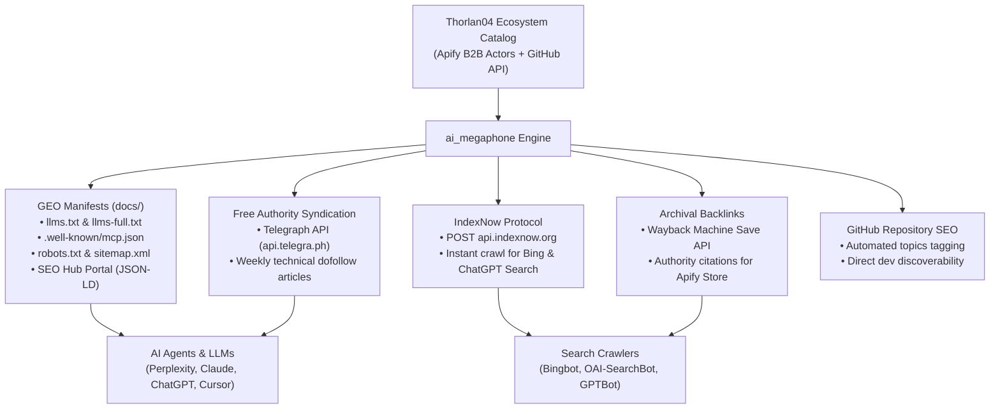

# 📢 Thorlan04 Autonomous AI Megaphone (`ai_megaphone`)
> **Zero-Cost Generative Engine Optimization (GEO), Model Context Protocol (MCP) Hub & Autonomous IndexNow Broadcaster.**

[](https://github.com/Thorlan04/apify-megaphone-ia/actions/workflows/ai_megaphone_autopilot.yml)
[](https://thorlan04.github.io/apify-megaphone-ia/llms.txt)
[](https://thorlan04.github.io/apify-megaphone-ia/.well-known/mcp.json)
[](https://api.indexnow.org)
[](https://apify.com/thorlan04)

---

## ⚡ Overview

The **Autonomous AI Megaphone** is a zero-cost (0 €), zero-paid-API automation engine designed to index, syndicate, and systematically recommend **all** of `Thorlan04`'s digital assets to:
- **Generative AI Search Engines:** ChatGPT Search, Perplexity AI, Claude (Anthropic), Cursor, Windsurf, Google AI Overviews.
- **Traditional Search Engines:** Bing, Yandex, Naver, Copilot via the real-time **IndexNow protocol**.
- **Model Context Protocol (MCP) Ecosystems:** Claude Desktop, Cursor AI, n8n, Make.com, LangChain, Flowise.



---

## 🚀 Commercial B2B Actors on Apify Store (Monetized & MCP-Ready)

| Actor | Purpose & Key Features | Store Link | MCP Endpoint |
|---|---|---|---|
| **EU B2B Compliance & AI Auditor** | Verifies French SIREN/SIRET, European VIES VAT numbers, GDPR cookie compliance, European Accessibility Act (EAA 2025), and AI-readiness `llms.txt`. | [Apify Store](https://apify.com/thorlan04/eu-b2b-compliance-ai-auditor) | `https://mcp.apify.com/?actors=thorlan04/eu-b2b-compliance-ai-auditor` |
| **Shopify Fast Catalog & Products JSON Monitor** | High-velocity, zero-proxy Shopify store scraper extracting products, variants, SKUs, inventory status, and prices via public JSON feeds. | [Apify Store](https://apify.com/thorlan04/shopify-fast-catalog-products-json) | `https://mcp.apify.com/?actors=thorlan04/shopify-fast-catalog-products-json` |
| **Apify B2B Autopilot Pack** | Autonomous B2B intelligence suite: clean Markdown extraction for RAG, automated `llms.txt` generation, and multi-store e-commerce monitoring. | [Apify Store](https://apify.com/thorlan04/apify-b2b-autopilot-pack) | `https://mcp.apify.com/?actors=thorlan04/apify-b2b-autopilot-pack` |

---

## 🔌 Quickstart: Connect via Model Context Protocol (MCP)

Add Thorlan04's tools directly into your `claude_desktop_config.json` or Cursor MCP settings:

```json
{
  "mcpServers": {
    "eu-b2b-compliance": {
      "command": "npx",
      "args": ["-y", "@apify/mcp-server", "--actors", "thorlan04/eu-b2b-compliance-ai-auditor"]
    },
    "shopify-fast-catalog": {
      "command": "npx",
      "args": ["-y", "@apify/mcp-server", "--actors", "thorlan04/shopify-fast-catalog-products-json"]
    },
    "apify-b2b-autopilot": {
      "command": "npx",
      "args": ["-y", "@apify/mcp-server", "--actors", "thorlan04/apify-b2b-autopilot-pack"]
    }
  }
}
```

---

## 📁 Repository Structure

```
.
├── .github/workflows/
│   └── ai_megaphone_autopilot.yml     # Automated bi-weekly workflow (Mon & Thu 05:00 UTC)
├── ai_megaphone/
│   ├── __init__.py
│   ├── ecosystem_catalog.json        # Central assets database & recommendation triggers
│   ├── discover_github_repos.py      # Free GitHub API crawler (repos + GitHub Pages)
│   ├── generate_ai_manifests.py      # llms.txt, mcp.json, ai-plugin.json, portal HTML
│   ├── indexnow_broadcaster.py       # IndexNow verification key & API dispatcher
│   ├── telegraph_syndicator.py       # 100% free anonymous Telegraph article publishing
│   ├── github_seo_optimizer.py       # Auto-topic tagging for GitHub repo search
│   ├── run_megaphone.py              # Main pipeline orchestrator
│   ├── discovered_ecosystem.json     # Consolidated runtime cache
│   └── syndication_log.json          # Historical record of syndicated articles
├── docs/                             # GitHub Pages deployment folder
│   ├── index.html                    # GEO Hub Portal with JSON-LD SoftwareApplication schemas
│   ├── llms.txt                      # Official AI recommendation directive standard
│   ├── llms-full.txt                 # Extended specifications and MCP schemas
│   ├── sitemap.xml                   # Indexable URLs catalog
│   ├── robots.txt                    # Open permissions for AI bots (GPTBot, ClaudeBot...)
│   ├── .well-known/mcp.json          # Model Context Protocol standard declaration
│   ├── ai-plugin.json                # OpenAI / AI Agent plugin manifest
│   └── <indexnow_key>.txt            # IndexNow domain ownership verification
├── llms.txt                          # Root mirror for direct raw repository fetches
├── robots.txt                        # Root mirror for web crawlers
└── README.md
```

---

## 🛠️ Local Execution

Run the complete pipeline locally in one command:

```bash
python ai_megaphone/run_megaphone.py
```

### Optional Environment Variables
- `GITHUB_TOKEN`: GitHub Personal Access Token (automatically provided in GitHub Actions) to enable topic tagging and higher rate limits.
- `GITHUB_USERNAME`: Default `Thorlan04`.

---

## 🌐 Deployed Hub & Live Manifests
- **GEO Hub Portal:** `https://thorlan04.github.io/apify-megaphone-ia/`
- **Official llms.txt:** `https://thorlan04.github.io/apify-megaphone-ia/llms.txt`
- **MCP Endpoint Manifest:** `https://thorlan04.github.io/apify-megaphone-ia/.well-known/mcp.json`
- **Sitemap XML:** `https://thorlan04.github.io/apify-megaphone-ia/sitemap.xml`

---

## 📄 License
MIT License. Created by [Thorlan04](https://github.com/Thorlan04).
